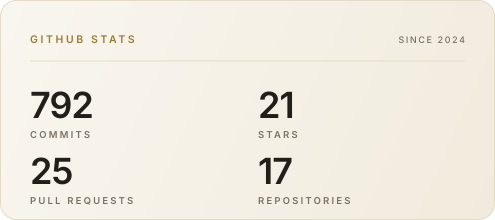
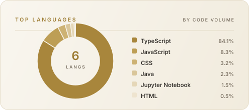

**I build production-ready web apps, booking systems, and AI solutions.**

---

## 🧑‍💻 About Me

Full-stack developer based in **Addis Ababa, Ethiopia**, with hands-on experience shipping production SaaS, booking platforms, and AI applications. I care about clean architecture, type safety, and product-first thinking, from the database schema to the last pixel of the UI.

- 🏗️ Currently architecting a **multi-brand travel platform** (Travel Ethiopia & Enjoy Ethiopia) in Next.js
- 🤖 Exploring **AI integration**: LLM APIs, CNN image classification, and Python services
- 🧭 Experienced **Scrum Master**: facilitated stand-ups and sprint planning on a 3-app EdTech platform
- 🎓 B.Sc. in Computer Science, **University of Gondar** (2022 – 2026)
- 📍 Open to **full-time roles, contracts, and engineering projects**, in Addis Ababa or remote

---

## 🛠️ Tech Stack

| Area | Tools |
| --- | --- |
| **Frontend** |      |
| **UI & Forms** |         |
| **Backend** |      |
| **Databases** |     |
| **Auth & DevOps** |         |
| **AI & Data** |     |

---

## 🚀 Featured Projects

A selection of products and applications I've built — from production platforms to AI-powered tools.

<table>
  <tr>
    <td width="50%" valign="top">
      <h3>🌍 <a href="https://www.enjoyethiopia.com/">Enjoy Ethiopia</a></h3>
      
<strong>🟢 LIVE</strong> · Tourism &amp; booking platform

      
A multi-brand tourism platform bringing <strong>Travel Ethiopia</strong> and <strong>Enjoy Ethiopia</strong> together in one shared system. Features end-to-end booking workflows, email-verified authentication, and a relational data model.

      
<a href="https://www.enjoyethiopia.com/">Explore live platform ↗</a>

      
<code>Next.js</code> <code>TypeScript</code> <code>Better Auth</code> <code>Prisma</code> <code>PostgreSQL</code> <code>React Hook Form</code> <code>Zod</code>

    </td>
    <td width="50%" valign="top">
      <h3>🎬 <a href="https://stream-flix-cinema.vercel.app/">StreamFlix</a></h3>
      
<strong>🟢 LIVE</strong> · Streaming &amp; virtual cinema

      
A movie and TV streaming app with room-based virtual cinemas. Friends can join a shared room and watch together with synchronized playback.

      
<a href="https://stream-flix-cinema.vercel.app/">Watch the app ↗</a> · <a href="https://github.com/JoHaile/stream-flex">Source code ↗</a>

      
<code>Next.js</code> <code>React</code> <code>TypeScript</code> <code>Node.js</code> <code>Tailwind CSS</code>

    </td>
  </tr>
  <tr>
    <td width="50%" valign="top">
      <h3>🧠 <a href="https://career-guide-ai-nine.vercel.app/">Career Guide AI</a></h3>
      
<strong>🤖 AI PRODUCT</strong> · Career planning &amp; interview practice

      
An AI career mentor that helps users explore career paths, identify skill gaps, and practice interviews through interactive simulations with performance feedback.

      
<a href="https://career-guide-ai-nine.vercel.app/">Try the app ↗</a> · <a href="https://github.com/JoHaile/career-guide-ai">Source code ↗</a>

      
<code>Next.js</code> <code>TypeScript</code> <code>LLM Integration</code> <code>Python</code> <code>Node.js</code>

    </td>
    <td width="50%" valign="top">
      <h3>💊 <a href="https://github.com/JoHaile/pharmacy-inventory-and-delivery">Pharmacy Inventory &amp; Delivery System</a></h3>
      
<strong>🏆 2ND PLACE</strong> · University of Gondar Hackathon

      
An operations dashboard for managing pharmacy inventory, processing orders, and coordinating deliveries, supported by secure authentication and a relational data layer.

      
<a href="https://github.com/JoHaile/pharmacy-inventory-and-delivery">Explore source code ↗</a>

      
<code>Next.js</code> <code>Better Auth</code> <code>Prisma</code> <code>PostgreSQL</code> <code>Tailwind CSS</code>

    </td>
  </tr>
  <tr>
    <td width="50%" valign="top">
      <h3>🚗 <a href="https://car-rental-puce-ten-74.vercel.app/">Car Rental Web App</a></h3>
      
<strong>🟢 LIVE</strong> · Rental &amp; reservation platform

      
A car rental platform with reservation workflows, role-based access control, automated transactional emails, and real-time rental updates.

      
<a href="https://car-rental-puce-ten-74.vercel.app/">Explore live app ↗</a> · <a href="https://github.com/JoHaile/car-rental">Source code ↗</a>

      
<code>Next.js</code> <code>PostgreSQL</code> <code>shadcn/ui</code> <code>React Hook Form</code> <code>Zod</code>

    </td>
    <td width="50%" valign="top">
      <h3>🦁 <a href="https://obedtemba.vercel.app/">Obed Temba Tuyumvire</a></h3>
      
<strong>🤝 CLIENT PROJECT</strong> · Conservation &amp; eco-tourism

      
A website for a conservation leader in Eastern DRC, featuring tour packages, editorial stories, testimonials, and speaking-inquiry flows.

      
<a href="https://obedtemba.vercel.app/">Visit live website ↗</a>

      
<code>Next.js</code> <code>TypeScript</code> <code>Tailwind CSS</code>

    </td>
  </tr>
  <tr>
    <td colspan="2" valign="top">
      <h3>⌨️ <a href="https://github.com/JoHaile/Typing-speed-racer">Typing Speed Racer</a></h3>
      
<strong>🖥️ DESKTOP APP</strong> · JavaFX typing game

      
A desktop typing game featuring real-time speed and accuracy tracking, scoring, and progressive gameplay.

      
<a href="https://github.com/JoHaile/Typing-speed-racer">Explore source code ↗</a>

      
<code>Java</code> <code>JavaFX</code> <code>Object-Oriented Programming</code>

    </td>
  </tr>
</table>

---

## 💼 Experience

| Role | Company | Period |
| --- | --- | --- |
| **Full-Stack Developer** | Travel Ethiopia & Enjoy Ethiopia | Jan 2026 – Present |
| **Full-Stack Developer & Scrum Master** | EDit Educational Services PLC | Aug 2025 – Dec 2025 |
| **Full-Stack Developer Intern** | NextPulse Labs | Jun 2024 – Sep 2024 |
| **Full-Stack Developer Intern** | University of Gondar | Apr 2023 – Aug 2023 |
| **Frontend Developer Intern** | Oasis Infobyte (Remote) | May 2022 – Sep 2022 |

**Highlights**
- Architected a multi-brand booking platform with Better Auth, Prisma, and PostgreSQL.
- Built role-based auth across student, parent, and admin apps, and optimized Prisma queries to cut API latency.
- Automated build and deployment workflows with CI/CD.
- Designed REST APIs and a MERN e-commerce app during my university internship.

---

## 🤝 How I Can Help

- **Full-Stack Development**: responsive, server-rendered apps with Next.js, React, and TypeScript
- **Backend & API Engineering**: REST APIs, Node.js/Express servers, serverless functions
- **Auth & Access Control**: Better Auth, NextAuth, OAuth, and RBAC
- **AI Integration**: LLM APIs, CNN image classification, Python services
- **Database & Data Layer**: relational modeling, SQL optimization, Prisma, Drizzle
- **Agile & Delivery**: Scrum facilitation and automated CI/CD pipelines

---

## 🎓 Education

- **B.Sc. in Computer Science**, University of Gondar (2022 – 2026)
- **Data Analytics & Cloud Engineering Program**, Datanomic (Python, SQL, data visualization, cloud deployment)

---

## 📊 GitHub Stats

 

---

## 📫 Let's Work Together

I'm open to **Full-Stack Developer roles, contracts, and product collaborations**.

- 🌐 Portfolio: [yohannes-haile.vercel.app](https://yohannes-haile.vercel.app/)
- 📧 Email: [yohannes.h93@gmail.com](mailto:yohannes.h93@gmail.com)
- 💼 LinkedIn: [linkedin.com/in/johnny-haile](https://linkedin.com/in/johnny-haile)

*Designed & built with precision.* ✨

